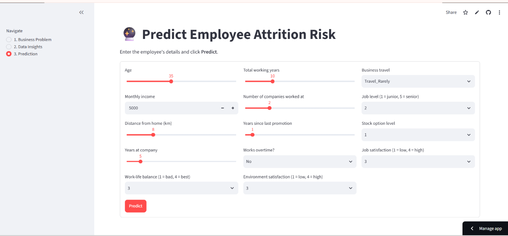

# Employee Attrition Predictor – a Decision Tool for HR

**Live app:** `<paste Streamlit link here>`  |  **Course:** Machine Learning for Business Applications (MBA – Business Analytics)

## Business Problem
Employee turnover is expensive (recruiting, training, lost productivity). HR wants to identify employees at risk of leaving *before* they resign.

## Objective
Build a classification model that predicts whether an employee will leave (`Attrition` = Yes/No) and deploy it as a web app that recommends a retention action.

## Dataset
IBM HR Analytics Employee Attrition & Performance (Kaggle). 1,470 rows × 35 columns, ~16% attrition. No missing values or duplicates. Located in `data/dataset.csv`.

## Methodology
Data → Cleaning → EDA → Feature Prep → Train/Test Split (80/20, stratified) → Model Training → Evaluation → Model Saving (`model.pkl`) → Streamlit App → Deployment

- **Cleaning:** dropped constant columns (EmployeeCount, Over18, StandardHours) and the ID column; kept income outliers (genuine senior staff).
- **Features (14):** Age, MonthlyIncome, DistanceFromHome, YearsAtCompany, TotalWorkingYears, NumCompaniesWorked, YearsSinceLastPromotion, OverTime, BusinessTravel, JobSatisfaction, WorkLifeBalance, JobLevel, StockOptionLevel, EnvironmentSatisfaction. Gender and marital status were excluded on purpose to avoid discriminatory decisions.
- **Preprocessing:** StandardScaler (numeric) + OneHotEncoder (categorical) inside one scikit-learn Pipeline.

## Model Used
Logistic Regression (`class_weight='balanced'`). Compared against Random Forest, which had higher accuracy but caught far fewer leavers.

## Model Performance (test set)
| Metric | Logistic Regression |
|---|---|
| Accuracy | 0.769 |
| Precision | 0.387 |
| **Recall** | **0.766** |
| F1 | 0.514 |
| ROC-AUC | 0.836 |

Recall is the priority metric: missing someone who leaves costs far more than an unnecessary check-in.

## Business Insights
- Employees working overtime leave at ~30% vs ~10% for others.
- First two years at the company are the highest-risk period (~30%).
- Frequent travellers and low-income employees leave more.

## How to Run
```bash
git clone <your-repo-url>
cd business-analytics-project
pip install -r requirements.txt
streamlit run app.py
```

## Repository Structure
```
app.py  model.pkl  requirements.txt  README.md
data/dataset.csv
notebooks/model_development.ipynb
images/
```

## Screenshots


## Limitations
Fictional dataset; small sample; correlation is not causation; model not validated on a real company's data.
## Deployed Application Link
https://business-analytics-project-hwwfsujghfvpakcnitrbht.streamlit.app/
